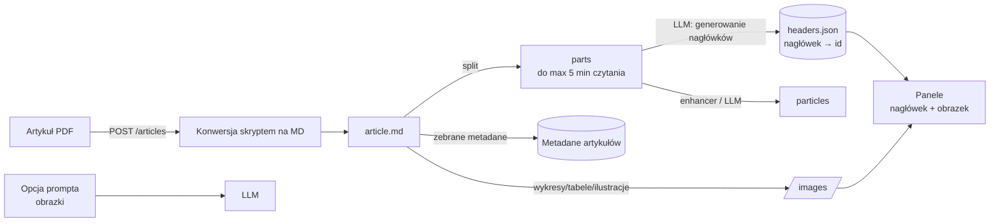

# P-article

Aplikacji mobilna ułatwiająca zapoznawanie się z artykułami naukowymi w przystępnej i angażującej formie. Inspirując się formatem znanym z mediów społecznościowych, takich jak Facebook, oraz krótkimi artykułami popularnonaukowymi, przygotujemy aplikację, która z wykorzystaniem SI będzie przekształcać wybrane artykuły naukowe w krótkie, zrozumiałe i atrakcyjne formy. Treści będą prezentowane w formie serii kart, które użytkownik będzie mógł przeglądać w wygodny, intuicyjny sposób.

### Wymagana funkcjonalność
Skracanie artykułu z zachowaniem sensu. Zapisanie widzianych przez użytkownika artykułów. Atrakcyjna strona graficzna.

### Opcjonalna funkcjonalność
Automatyczne proponowanie zbliżonych tematycznie artykułów.

## Status log

| data       | status |
|------------|--------|
| 23.10.2026 | Eksperymentowanie z modelami do skracania artykułów |
| 30.10.2026 | Wstępna konfiguracja projektu aplikacji Android |
| 08.11.2026 | Prototyp interfejsu aplikacji i pipeline’u generowania p-articles |

## Słownik pojęć
 
| Pojęcie | Znaczenie |
|---------|-----------|
| **artykuł** (`art-id`) | Oryginalny artykuł naukowy wgrany jako PDF. |
| **part** (`part-id`) | Fragment artykułu w formacie Markdown, wynik podziału `article.md`; docelowo do ok. 5 minut czytania. |
| **particle** (p-article) | Part po przetworzeniu przez LLM („enhancer”) — skrócona, przystępna wersja, którą czyta użytkownik. |
| **header** (nagłówek) | Krótki, chwytliwy nagłówek wygenerowany przez LLM dla partu (w jednym parcie może być ich kilka: `h1`, `h2`, `h3`…). |
| **panel** | Karta na ekranie głównym: `nagłówek + obrazek`. Kliknięcie panelu otwiera particle. |
| **status** | Decyzja/stan użytkownika dla partu, np. przeczytany, zapisany na później, ukryty. |

## Dokumentacja

### Struktura projektu

- `app/` — aplikacja Android napisana w Kotlinie, z interfejsem Jetpack Compose i nawigacją Navigation Compose. Kod jest podzielony na warstwę danych (`data/`) oraz ekrany i ich ViewModele (`ui/`).
- `backend/` — serwer HTTP FastAPI oraz skrypt parsujący PDF-y.
- `test_data/` — przykładowe dane używane w eksperymentach z przetwarzaniem artykułów.

Moduł Android ma `minSdk 24`, `compileSdk 37` i kompiluje kod JVM z kompatybilnością Java 11. Lista artykułów jest obecnie dostarczana przez `FakeArticleRepository` (dane przykładowe); wyniki parsowania backendu nie są jeszcze podłączone do repozytorium ani listy artykułów w aplikacji. Statusy decyzji o artykułach są przechowywane w pamięci, natomiast ustawienie trybu ciemnego jest zapisywane w `SharedPreferences`.

### Przesyłanie i parsowanie PDF

Ekran dodawania artykułów umożliwia wybór wielu plików PDF. Aplikacja przetwarza je kolejno w kolejce i dla każdego wysyła żądanie `POST /articles?filename=<nazwa>` z treścią pliku jako `application/pdf`. URL serwera jest ustawiany właściwością Gradle `parserServerUrl`; domyślnie wynosi `http://10.0.2.2:8000` (adres hosta widoczny z emulatora Androida).

Backend waliduje rozszerzenie i nagłówek PDF, przyjmuje pliki do 200 MB, a parsowanie wykonuje pojedynczo. Odpowiedź sukcesu zawiera nazwę katalogu wynikowego (`{"folder":"..."}`). Wynik zapisywany jest w `backend/output/<nazwa>/` i obejmuje `article.md`, katalog `images/` oraz kopię źródłowego PDF-a. Parser wykorzystuje PyMuPDF i PyMuPDF4LLM.

Instrukcje instalacji zależności, uruchomienia serwera oraz konfiguracji połączenia z emulatorem lub urządzeniem znajdują się w [backend/README.md](backend/README.md).

## Koncepcj docelowego rozwiązania
 
Poniższe sekcje opisują docelową architekturę zaplanowaną podczas sesji projektowych. Elementy oznaczone jako *planowane* nie są jeszcze zaimplementowane — aktualny stan opisano w sekcjach powyżej.
 
### Pipeline przetwarzania artykułu
 

 
Etapy:
 
1. **Wejście** — artykuł w PDF, opcjonalnie z opcją prompta (np. styl skracania) oraz obrazkami wyciągniętymi z dokumentu.
2. **Konwersja** — skrypt (PyMuPDF/PyMuPDF4LLM, już zaimplementowany) zamienia PDF na `article.md` + `images/`.
3. **Podział (`split`)** — LLM dzieli Markdown na części (`parts`) o długości do ok. 5 minut czytania. Każdy part dostaje identyfikator (`part-id`).
4. **Generowanie nagłówków** — dla każdego partu LLM tworzy nagłówki (mapowanie `nagłówek → id`). Do paneli wybierane są obrazki (na tablicy: „wybór (2 tagów?)” — liczba obrazków/tagów do ustalenia).
5. **Enhancer** — LLM przekształca part w *particle* (skrócony, przystępny tekst). 
6. **Metadane** — z całego artykułu zbierane są metadane (unikalne rekordy), dzięki którym artykuł jest od razu widoczny jako **① dostępny**.

### Ekrany (UI)
 
1. **Strona główna** — panel główny z kartami (nagłówek + obrazek).
2. **Strona artykułu** — treść particle’a (obrazek + tekst) z przyciskiem przejścia do następnego partu.
3. **Wczytywanie artykułów** — wybór plików PDF-ów i inicjalizacja kolejki przetwarzania.
4. **Panel historii / notatek** — historia czytania oraz notatki.
5. **Ustawienia** — m.in. tryb ciemny , docelowo personalizacja prompta.

### Planowane funkcjonalności aplikacji
 
- **Opcja „nie pokazuj”** — ukrycie artykułu/particla z feedu.
- **Zapisz na później** — odłożenie particla do późniejszego przeczytania.
- **Historia** — lista przeczytanych elementów w kolejności czytania.
- **Statystyki** — ile artykułów przeczytano oraz kiedy.
- **Priorytetyzuj rozpoczęte** — artykuły już zaczęte pojawiają się wyżej w feedzie.
- **Zachęta do następnego** — po zakończeniu partu aplikacja od razu proponuje kolejny.
- **Rekomendacje** — propozycje zbliżonych tematycznie artykułów (opcjonalnie).
- **Quiz / pole na przemyślenie** *(do rozważenia)* — pytania sprawdzające (`id ↔ pytanie`) i miejsce na własne notatki.
- **Personalizacja prompta** *(do rozważenia)* — wpływ użytkownika na sposób skracania.

## Autorzy

 - [Kinga Bunkowska](https://github.com/KingaBunkowska)
 - [Maciej Nowakowski](https://github.com/MaciekBartoszNowakowski)
 - [Albert Peciak](https://github.com/AlbertPec)